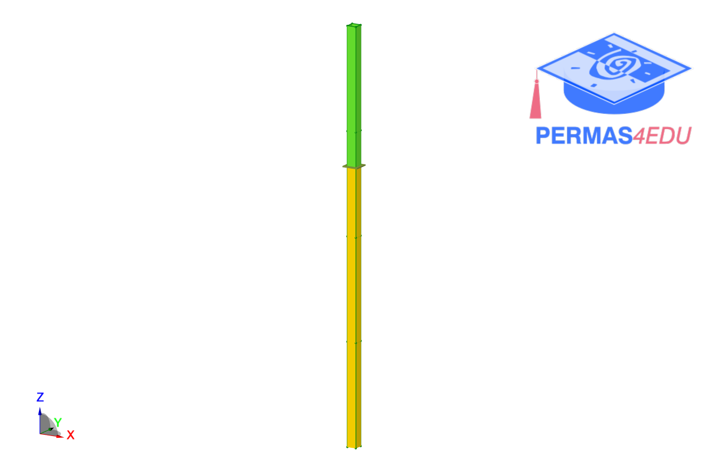

***
[⬅️](../121/README.md "Previous example")
[➡️](../123/README.md "Next example")
***
The example is adapted from [ROTMAC and subspace MAC for the correlation of systems with complex modes: Theory and practical application](https://doi.org/10.1016/j.engstruct.2026.123907)

