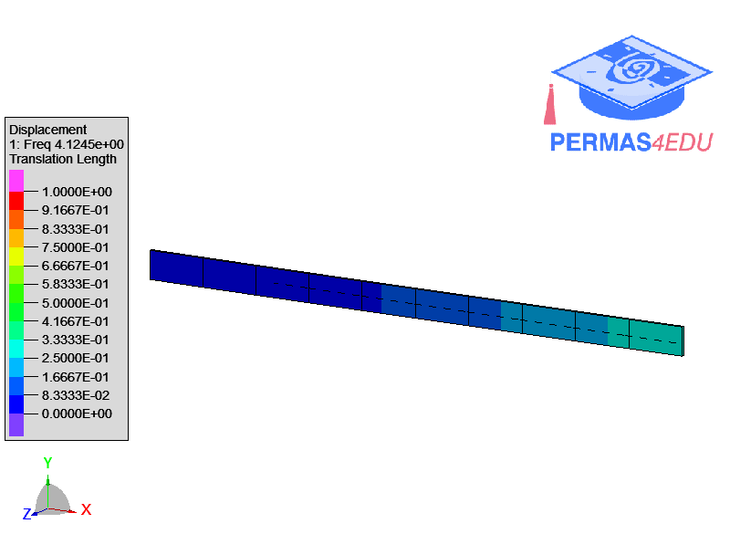

***
[⬅️](../124/README.md "Previous example")
[➡️](../126/README.md "Next example")
***
The example is adapted from [Knowledge transfer for structural damage detection through re-weighted adversarial domain adaptation](https://doi.org/10.1016/j.ymssp.2022.108991)

