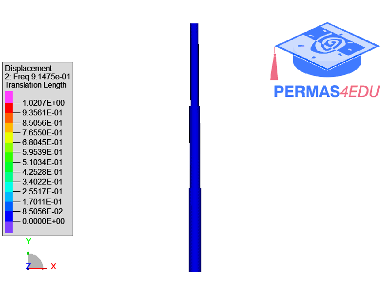

***
[⬅️](../128/README.md "Previous example")
[➡️](../README.md "Go up one directory level")
***
The example is adapted from [Redundancy control in sensor placement for modal testing](https://doi.org/10.1016/j.jsv.2026.120236)

