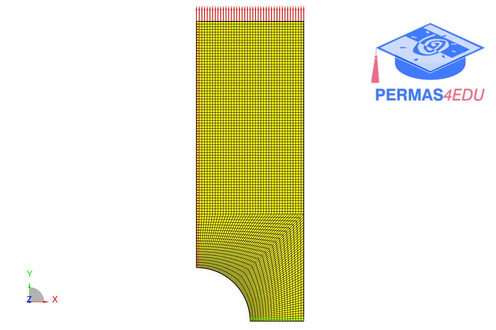
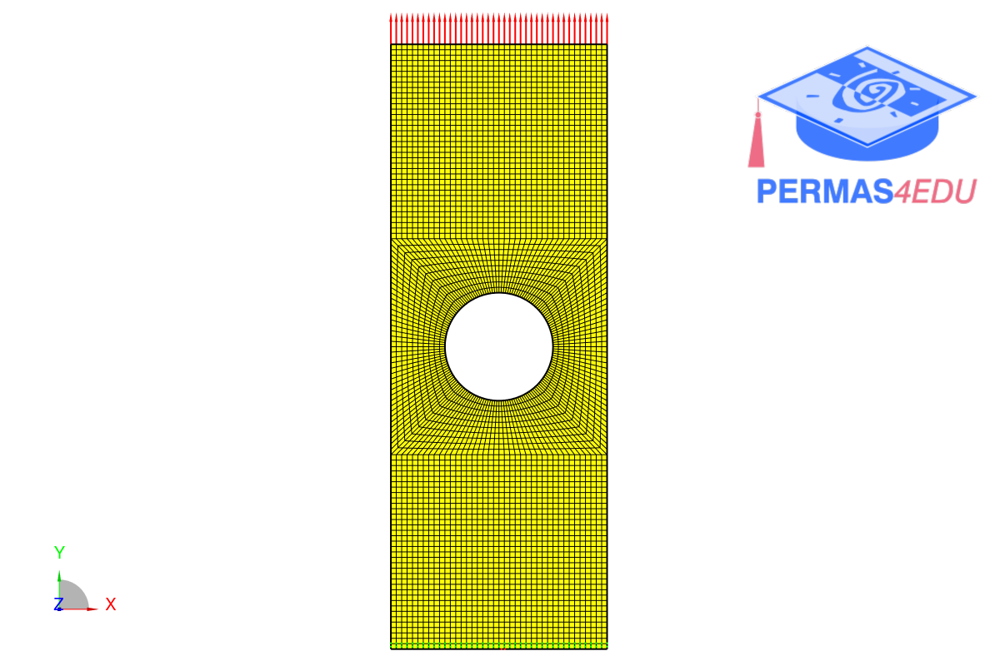

***
[⬅️](../048/README.md "Previous example")
[➡️](../050/README.md "Next example")
***
The example is adapted from [The patch tests for verification of machine learning procedures](https://doi.org/10.1016/j.compstruc.2026.108331)

 

