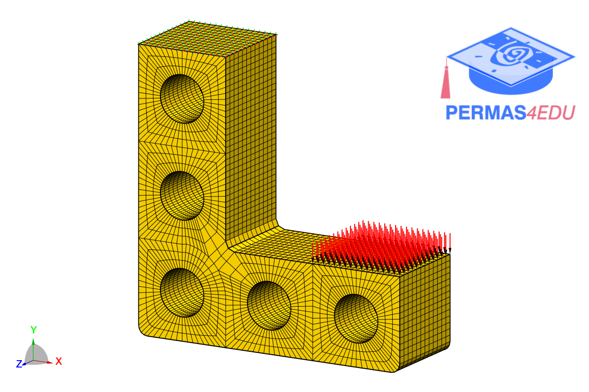

***
[⬅️](../049/README.md "Previous example")
[➡️](../README.md "Go up one directory level")
***
The example is adapted from [Even more design constraints for parameter-free shape optimization](https://doi.org/10.1007/s00158-026-04409-4)

