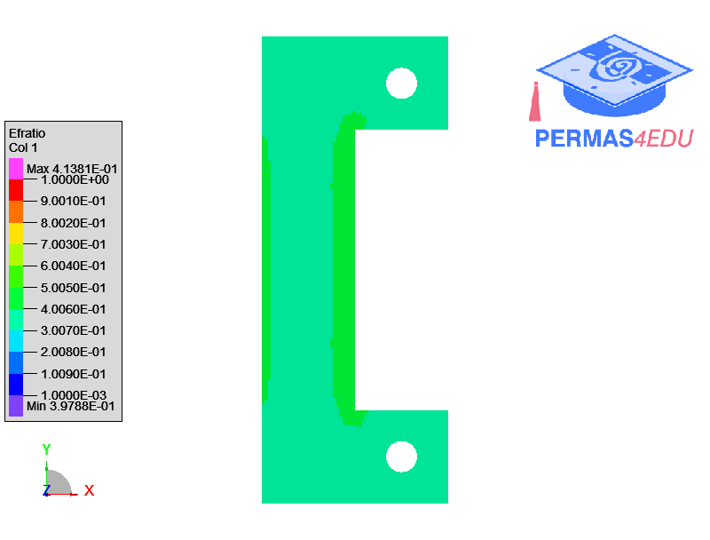

***
[⬅️](../062/README.md "Previous example")
[➡️](../README.md "Go up one directory level")
***
The example is adapted from [Teaching Topology Optimization Through Polymer Material Extrusion Prototyping: A Transferable CAD‐CAE‐AM Framework With Numerical‐Experimental Validation](https://doi.org/10.1002/cae.70291)

