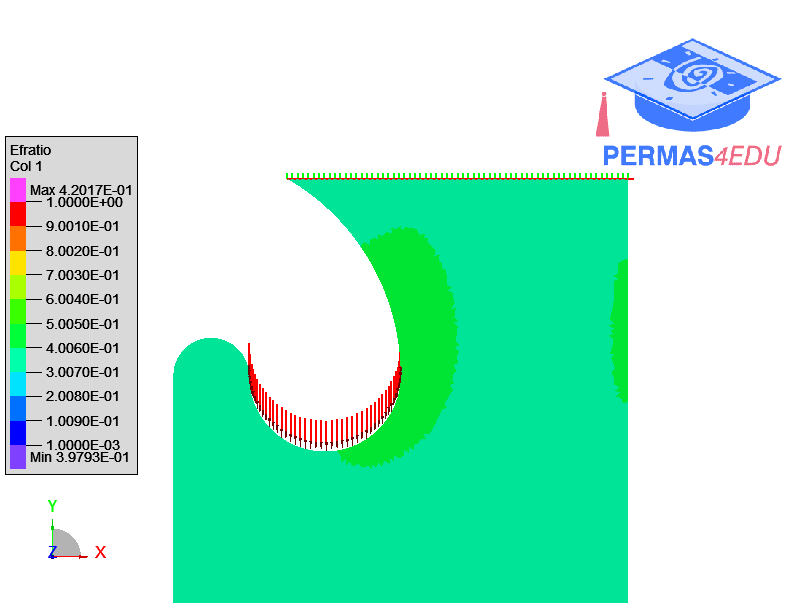

***
[⬅️](../063/README.md "Previous example")
[➡️](../README.md "Go up one directory level")
***
The example is adapted from [Voronoi diagram-based volume decomposition and overhang control in topology optimization for multi-axis additive manufacturing](https://doi.org/10.1007/s00366-026-02438-7)

