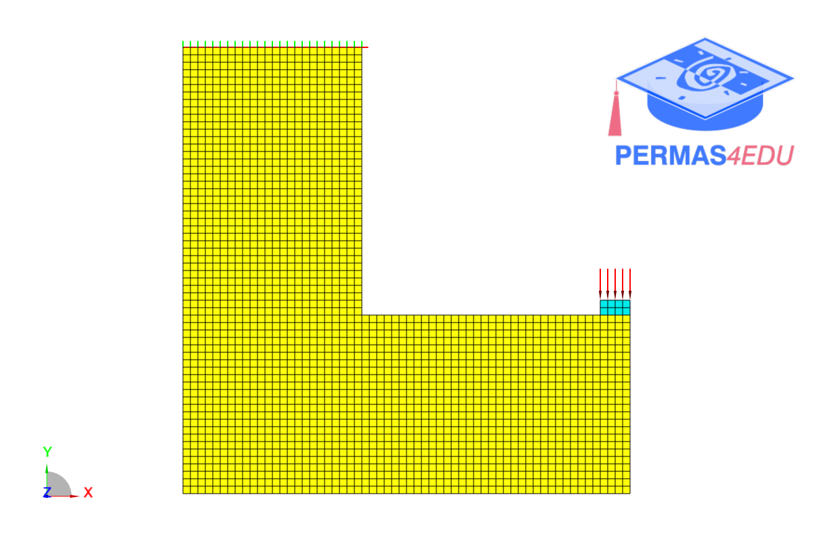

***
[⬅️](../064/README.md "Previous example")
[➡️](../README.md "Go up one directory level")
***
The example is adapted from [Data-driven multifidelity multiscale topology optimization via phasor-based evolutionary de-homogenization](https://doi.org/10.1016/j.engstruct.2026.124076)

